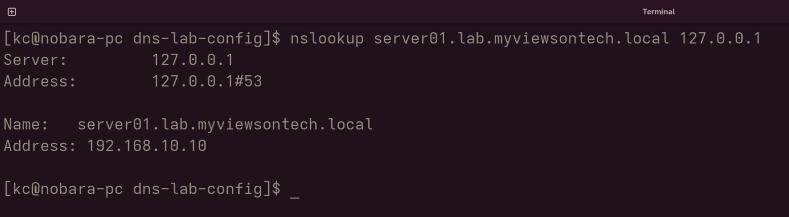
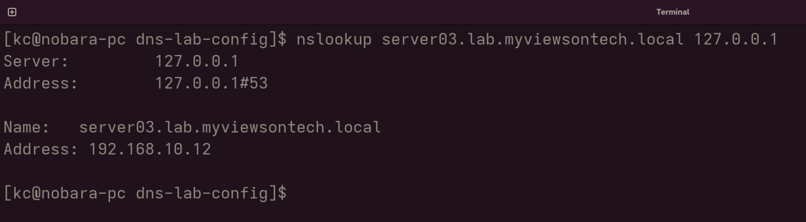
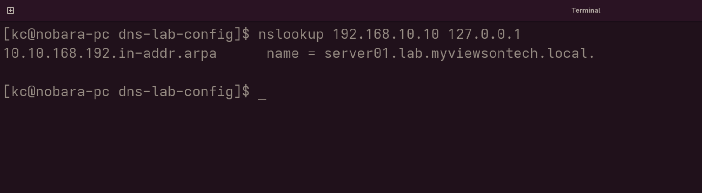
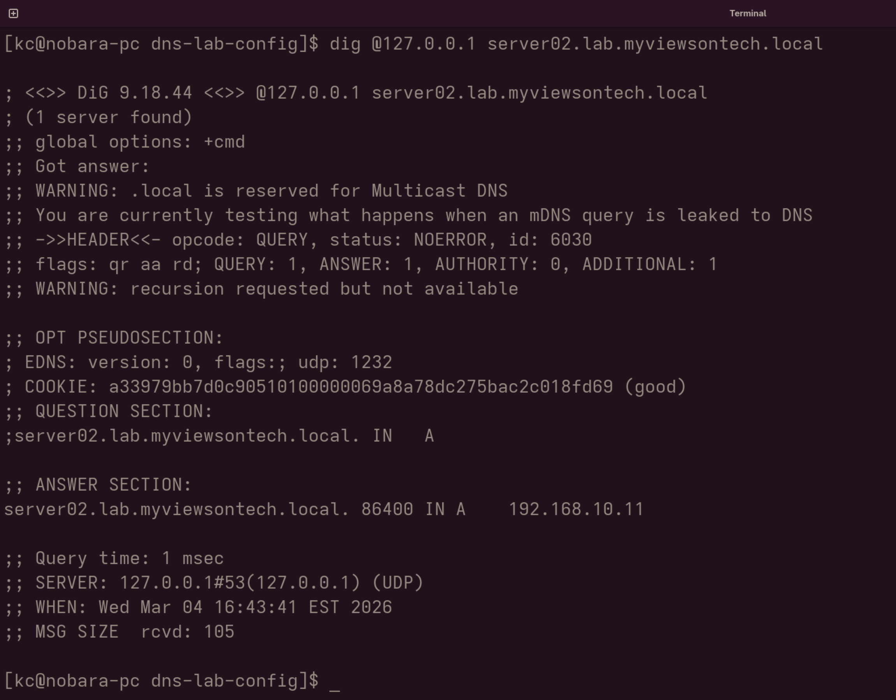

# dns-lab-config

Configured a BIND9 DNS server with forward and reverse lookup zones
for a simulated lab network. Verified correct name resolution
using nslookup and dig across multiple subnets.

## Architecture

<p align="center"></p>

**Why this architecture**

| Choice | Why |
|---|---|
| BIND9 in Docker (official `internetsystemsconsortium/bind9:9.18` image) | One `docker compose up -d` starts the server; nothing is installed on the host. |
| Config and zones mounted from the repo | Edit the files in git, restart the container; the image stays untouched. |
| Authoritative only (`recursion no`) | The server answers for the lab zones and nothing else, so it can't be used as an open resolver. |
| Separate forward and reverse zones | Name → address and address → name both work, which `nslookup` and `dig` checks need. |
| Port 53 on UDP and TCP | UDP for normal queries, TCP for large answers and zone transfers. |

**Records** (`config/zones/`): `ns1` 192.168.10.1, `server01` .10, `server02` .11, `server03` .12, each with a matching PTR.

## Results

**Live queries** against the running container (screenshots below, taken 2026-03-04 on the author's machine):

| Query | Answer |
|---|---|
| `nslookup server01/02/03.lab.myviewsontech.local 127.0.0.1` | 192.168.10.10 / .11 / .12 |
| `nslookup 192.168.10.10 127.0.0.1` | `server01.lab.myviewsontech.local.` |
| `dig @127.0.0.1 server02.lab.myviewsontech.local` | `NOERROR`, `aa` (authoritative) flag, A 192.168.10.11, query time 1 ms |

**Zone consistency check** — [`scripts/check_zones.py`](scripts/check_zones.py) checks, without BIND, that every A record
has a PTR pointing back to the same name (and the other way round) and that both zones use the same SOA serial:

```text
$ python3 scripts/check_zones.py
OK   ns1.lab.myviewsontech.local.         A 192.168.10.1   PTR -> ns1.lab.myviewsontech.local.
OK   server01.lab.myviewsontech.local.    A 192.168.10.10  PTR -> server01.lab.myviewsontech.local.
OK   server02.lab.myviewsontech.local.    A 192.168.10.11  PTR -> server02.lab.myviewsontech.local.
OK   server03.lab.myviewsontech.local.    A 192.168.10.12  PTR -> server03.lab.myviewsontech.local.
OK   both zones use SOA serial 2024030101

4 A records, 4 PTR records, 0 problem(s)
```

(Run 2026-11-13, Python 3.14, Linux.) BIND's own checkers can be run inside the container:

```bash
docker exec dns-lab named-checkconf -z /etc/bind/named.conf
```

## What worked and what didn't

| | |
|---|---|
| ✅ | Forward and reverse lookups returned the right answers for every record that was queried (screenshots). |
| ✅ | Answers come back authoritative (`aa` flag) in about 1 ms. |
| ⚠️ | Getting the config mounted where BIND reads it took several commits: it was mounted as `dns-server.conf`, then `named.conf.local` (with `include` lines for the image's default files, later removed), and finally as `/etc/bind/named.conf`. The obsolete `version: "3"` line was also removed from the compose file. |
| ⚠️ | `dig` warns that `.local` is reserved for Multicast DNS. A name such as `lab.internal` or a subdomain of a real domain would avoid clashes with mDNS. |
| ⚠️ | `dig` also warns "recursion requested but not available". That is expected with `recursion no`, but it means clients can't use this server for internet names. |
| ⚠️ | No secondary server is set up; it is a single-server lab. |

## Structure
- `docker-compose.yml` — spins up BIND9 container
- `config/dns-server.conf` — DNS server configuration (mounted as `/etc/bind/named.conf`)
- `config/zones/lab.myviewsontech.local.zone` — forward lookup zone
- `config/zones/reverse.zone` — reverse lookup zone
- `scripts/check_zones.py` — forward/reverse consistency check (Python 3, no extra packages)
- `docs/architecture.svg` — the diagram above

## Usage
```bash
docker compose up -d
```

## Verification
```bash
# Forward lookup
nslookup server01.lab.myviewsontech.local 127.0.0.1

# Reverse lookup
nslookup 192.168.10.10 127.0.0.1

# Using dig
dig @127.0.0.1 server02.lab.myviewsontech.local
```

## Skills Demonstrated
- DNS server configuration (BIND9)
- Forward and reverse lookup zones
- Lab network name resolution
- Containerised infrastructure setup

## Verification Output






